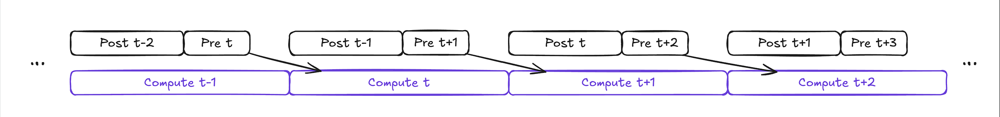
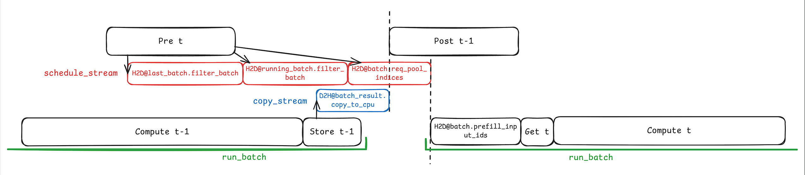

ref：https://zhuanlan.zhihu.com/p/1969077475129688722

---

粘贴出的代码段可能经过简化，去除了与讨论无关的细节

所有函数名在引用时使用行内代码包裹，变量则直接书写。代码段开头用注释标记了端到端流程中执行到该片段的栈帧，如果没有标注则表示和上一段相同

Scheduler 的主要代码都位于仓库中的 python/sglang/srt/managers/scheduler.py

---

SGLang 有三个核心进程

- **TokenizerManager**：http gateway 和 tokenize。经过处理的请求发给 Scheduler
- **Scheduler**：推理调度。将输出发给 DetokenizerManager
- **DetokenizerManager**：detokenize 后将字符串结果发回 TokenizerManager

三个核心进程之间使用 ZMQ IPC 通信

我们将着重研究 Scheduler 的调度流水线。为了简化讨论假设在单机单卡上推理，忽略 PD 分离等特性

---

# Normal Loop

在<u>**非 overlap 模式**</u>下 Scheduler 的主循环是这样的：

```python
# Scheduler.event_loop_normal

while True:
    self.ingest_requests()
    plan = self.get_next_batch_to_run(...)
    batch = plan.batch_to_run
    if batch:
        result = self.run_batch(batch)
        self.process_batch_result(batch, result)
    self.last_batch = batch
```

- `ingest_requests` 从 ZMQ 拉取请求，将请求放入 waiting_queue 里。waiting_queue 是一个等待被 prefill (extend) 的队列，running_batch 是目前还在等待 decode 的 batch
- `get_next_batch_to_run` 同时考虑上一拍 batch 的处理结果、waiting_queue 和 running_batch，给出下一拍应该运行的 batch 以及新的 running_batch
- `run_batch` 将 batch 发送到 GPU 上运行一步推理
- `process_batch_result` 执行后处理，对于 prefill 结果来说更新 RadixCache，对于 decode 结果来说考虑请求是否已经完成，更新缓存并将结果送到 Detokenizer

---

# Overlap Loop

```python
self.result_queue = deque()

def pop_and_process():
    old_batch, old_result = self.result_queue.popleft()
    self.process_batch_result(old_batch, old_result)

while True:
    if self.gracefully_exit:
        break

    self.ingest_requests()

    plan = self.get_next_batch_to_run(
        running_batch=self.running_batch,
        last_batch=self.last_batch,
    )
    self.running_batch = plan.running_batch
    batch = plan.batch_to_run

    disable_overlap_for_batch = self.is_disable_overlap_for_batch(
        batch, last_batch=self.last_batch
    )

    if disable_overlap_for_batch:
        pop_and_process()

    if batch:
        batch_result = self.run_batch(batch)
        self._apply_war_barrier()
        self.result_queue.append((batch.copy(), batch_result))
    else:
        batch_result = None
        self._sched_idled = True

    if self.last_batch:
        if not disable_overlap_for_batch:
            pop_and_process()
    elif batch is None:
        self.on_idle()

    if self.is_generation:
        self.launch_batch_sample_if_needed(batch_result, batch)

    self.last_batch = batch
```

总体来说，非 overlap 循环可以划分为串行执行的三个阶段

- **Pre schedule**：接收及调度请求，匹配 cache，分配请求所需内存资源，以及做一些推理启动前的准备工作
- **Compute batch**：将 batch 发送到 GPU 上运行一步推理并采样
- **Post schedule**：检查请求是否完成，送 Detokenizer 等

实现 overlap 的关键在于调整 loop 的各阶段执行顺序，错开两步推理，同时使用 stream 异步执行命令

具体来说，Pre Schedule 执行完成后 Compute Batch 在 GPU 上启动，此时 CPU 空闲，我们虽然不能立刻运行当前 batch 的 Post Schedule，但是可以运行**上一拍**的 Post Schedule

因此调整 loop 为 Pre N -> Compute N -> Post N-1 -> Pre N+1 -> Compute N+1 -> Post N -> … 这样的循环即可将 Post 部分的耗时和 Compute 重叠起来，提升吞吐量



我们将基于这个流水线草图不断补充 loop 的细节

---

可以注意到这样一个问题：当我们 Pre Schedule N+1 拍时，第 N 拍往往还在计算中，这意味着在选择哪些请求会进入下一拍的 batch 时，我们不会知道哪些请求在第 N 拍已经结束

但这并不影响最终输出的正确性。CPU 只使用已知信息规划，最多只会将已结束的请求多算一拍

- 假设流水线正在不停 decode 一批请求，现在开始 Pre Schedule N+1 拍。在第 N 拍推理中存在两个请求 A、B，请求 A 会在第 N 拍采样出 EOS 从而结束，请求 B 不会结束
- 当我们 Pre N+1 时无法得知这些信息，目前看来 A、B 都未结束，因此他们都被加入了 N+1 拍的 batch
- 当我们 Post Schedule N 时发现 A 已经结束，因此在 A 请求上标记 finished
- 在 Pre Schedule N+2 的时候我们会发现 A 已经结束，从而将 A 请求移出 batch
- 这一过程里我们只是将已经 EOS 的请求 A 多算了一拍，新产生的无效 token 并未被输出

---

## FutureMap

观察 GPU 上的流水线，后一拍推理需要用到前一拍采样出的 token id 结果

显然我们不应该把前一拍的结果 d2h 到 CPU 再 h2d 回来给下一拍，因此我们需要一个显存上的 buffer 来存放可以直接在 GPU 上跨步传递的信息，这就是 **FutureMap**

FutureMap 是显存上的一组持久 tensor，在 `Scheduler.init_overlap()` 中创建，容量对齐 `ReqToTokenPool`。也包含少量放在 CPU pinned memory 上的镜像 tensor 以便读写

### 槽位号

- 新请求在 `ingest_requests` 内被包装成 Req 对象塞入 waiting_queue 中

- `get_next_batch_to_run` 先尝试 `get_new_batch_prefill`，后者将 Req 对象从 waiting_queue 中取出并构造 ScheduleBatch 对象

- ScheduleBatch 被返回前先调用 `ScheduleBatch.prepare_for_extend`，其中调用 `alloc_for_extend`

- `alloc_for_extend` 会给请求分配 ReqToTokenPool 行，将必要信息 h2d，调用 `alloc_req_slots`

- `alloc_req_slots` 会从 host 侧的 free_slots 取槽位号，保存槽位号到每个请求的 req.kv.req_pool_idx

- `alloc_for_extend` 在每个槽位号分配完成之后提取所有请求的槽位号建立索引 tensor

  ```python
  req_pool_indices = alloc_req_slots(
      batch.req_to_token_pool, batch.reqs, batch.tree_cache
  )
  req_pool_indices_cpu = torch.tensor(
      req_pool_indices, dtype=torch.int64, pin_memory=pin_memory
  )
  req_pool_indices_device = req_pool_indices_cpu.to(
      batch.device, non_blocking=True
  )
  ```

- 这两个索引最终会变成

  - `batch.req_pool_indices_cpu`
  - `batch.req_pool_indices`

这部分的 h2d 操作全部插入在 schedule_stream 上

综上所述，在 Pre Schedule 阶段时，如果成功构造新 batch 则其中的请求被分配固定的槽位号，整个 batch 的槽位号索引 req_pool_indices 通过 schedule_stream 送到 GPU

### Store next token ids

FutureMap 中我们重点关注 `output_tokens_buf`，这是一个长度和总槽位数一致，保存 int64 的一维 tensor，也就是槽位域上的桶，用来保存前一步推理采样得到的 token ids

`Scheduler.run_batch` 内部会通过 `self._forward_isolation` -> `batch_result = self.model_worker.forward_batch_generation` 获得一拍推理的结果 `batch_result`

在不启用延迟 sample 的情况下，此时我们已经采样出了新 token，存放在 batch_result.next_token_ids 中

`run_batch` 会调用 `_relay_forward_payload` 把 batch_result.next_token_ids 包装成 RelayPayload 对象

RelayPayload 对象传入 `FutureMap.stash` 函数，通过一次 scatter 保存进 FutureMap.output_tokens_buf 中

```python
self.output_tokens_buf[indices] = payload.bonus_tokens.to(
    self.output_tokens_buf.dtype
)
```

`_relay_forward_payload` 还会调用 `batch_result.copy_to_cpu`，把 next_token_ids、logprob、hidden_states 等信息通过 copy_stream d2h 传回 host 侧

### Get next token ids

在下一拍推理时，我们会在 `run_batch` 的 `resolve_forward_inputs` 调用中判断，如果采用普通的非投机解码，直接从 FutureMap.output_tokens_buf 来 gather 出 batch.req_pool_indices 即可拿到 input_ids

```python
elif batch.input_ids is None and future_map.spec_algo.is_none():
    batch.input_ids = future_map.output_tokens_buf[batch.req_pool_indices]
```

### Batch 维护

一个 batch 在连续多拍 decode 期间其包含的请求可能发生变化

#### 请求退出

去除已完成的请求是通过在 `get_next_batch_to_run` 中对 batch 对象调用 `.filter_batch` 实现的

在 `filter_batch` 函数内部，CPU 先根据 finished 状态和 excluded 参数计算出要保留的请求的**下标**。这里的下标指的是相对于 `batch.req_pool_indices`，哪些位置的请求要被留下

```python
if keep_indices is None:
    if isinstance(reqs_to_exclude, Req):
        reqs_to_exclude = [reqs_to_exclude]
    elif reqs_to_exclude is None:
        reqs_to_exclude = []
    keep_indices = [
        i
        for i in range(len(self.reqs))
        if not self.reqs[i].finished() and self.reqs[i] not in reqs_to_exclude
    ]
```

利用这个 keep_indices 我们构造出 tensor

```python
keep_indices_device = torch.tensor(
    keep_indices,
    dtype=torch.int64,
    pin_memory=is_pin_memory_available(self.device),
).to(self.device, non_blocking=True)
```

再利用该 tensor 对原有的 req_pool_indices 进行一次 gather 更新，由此去除不需要的请求

```python
self.req_pool_indices = self.req_pool_indices[keep_indices_device]
self.req_pool_indices_cpu = self.req_pool_indices_cpu[keep_indices]
```

每次 `filter_batch` 都会触发 h2d 传输以及 gather 操作，这些操作被插入到 schedule_stream 中

#### batch 合并

`batch.merge_batch(other)` 可以实现 batch 合并

合并只需要把 req 列表拼接，同时将 GPU 上的 req_pool_indices 也拼接即可，拼接命令插入到 schedule_stream

#### 新请求加入

新请求总是需要先经过 prefill 再进入 decode 阶段

对于 prefill batch 或者 mixed batch 来说，其中的 prefill 请求在两拍之间的输入并不从 FutureMap 中 gather

`prepare_for_extend` 会整理所有需要 prefill 的请求的 prompt，塞进 pinned CPU tensor，保存为 batch.prefill_input_ids_cpu

在 `run_batch` 中 forward 之前，`resolve_forward_inputs` 会把 prefill_input_ids_cpu 做 h2d 拷贝到 GPU，此命令插入到 forward_stream 中

在请求的 prefill 完成之后自然采样出第一个 token 填入 FutureMap 中，即可继续 decode

上面的逻辑很简单，但神秘的是 h2d 传输 prompt 的时机和传输 req_pool_indices 的时机完全不同

对比前面的介绍，早在 `get_next_batch_to_run` 中 req_pool_indices 的 h2d 就已经触发，指令在 schedule_stream 中。但 prefill_input_ids 不选择在此时 h2d，相反这里刻意只把 prompt 塞进 CPU memory

直到 `run_batch` 中先 `forward_stream.wait_stream(schedule_stream)`，再在 forward_stream 上触发 prompt h2d

因此 forward_stream 会被 prompt h2d 阻塞，这段时间不会像 req_pool_indices h2d 一样被 overlap，为什么？我还没研究明白

---

假设第 t-1 batch 是 prefill batch，prefill 一轮之后全部完成转入 running_batch，第 t 轮 Pre Schedule 阶段新构造一个 prefill batch，两拍之间的流水线如下所示

最下面的 GPU 线等同于 forward_stream。为了表现同步逻辑，各阶段的比例和真实情况不同



---

## WAR barrier

[WIP]

---

---

## ingest_requests

`self.ingest_requests` 主要做如下动作

- 调用 `request_receiver.recv_requests`。其内部执行一个 while 循环，不断从 ZMQ 队列里非阻塞拉取请求，直到 ZMQ 队列空或者拉取足够 max_recv_per_poll 次

  每次拉取到的可能是包含单个请求的 TokenizedGenerateReqInput，或者包含一组请求的 BatchTokenizedGenerateReqInput

- 调用 `process_input_requests`。遍历拉取到的所有请求，对于每个 TokenizedGenerateReqInput 调用 `handle_generate_request`（对于 BatchTokenizedGenerateReqInput 则是遍历其内部的每个请求调用 `handle_generate_request`），该函数将创建 Req 对象

- `_add_request_to_queue` 考虑每个 Req 对象该被推到哪个队列里。对于非 PD 分离情况，所有的 Req 全部塞到 waiting_queue 里

可见，通常情况下新请求会全部变成 Req 被塞到 waiting_queue 里，等待调度

---

---

## get_next_batch_to_run

**我们将先假设一个 batch 的 forward_mode 只能是 EXTEND 或者 DECODE**。后面讨论 MIXED 的处理

`self.get_next_batch_to_run` 做如下动作

---

### 处理上一个 batch 的影响

对于 forward_mode 为 EXTEND 的 batch（prefill batch），它由**至多一个 chunked_req**，外加若干无需 chunked 的请求构成

如果上一个 batch 是 prefill batch，此时应该把所有做完 prefill 的请求加入 **runnning_batch**。running_batch 是当前正等待 decode 的 batch。chunked_req 因为还未完成 prefill 所以不该加入 running_batch，需要特殊剔除

```python
# Scheduler.event_loop_normal
#  - Scheduler.get_next_batch_to_run

chunked_req_to_exclude = set()
if self.chunked_req is not None:
    chunked_req_to_exclude.add(self.chunked_req)
    if self.chunked_req.extend_range.end > len(self.chunked_req.prefix_indices):
        self.stash_chunked_request(self.chunked_req)
```

> 这里 `self.stash_chunked_request` 是用来将 chunked_req 刚刚算出来的一部分 KV 注册到 RadixCache 树里，以便下一个 chunk 通过 `match_prefix` 复用这些 KV
>
> 对于那些无需 chunked 的请求，它们在 prefill 完成时的 `process_batch_result_prefill` 里被处理（具体来说，是处理所有 req.inflight_middle_chunks <= 0 的请求），如果请求已经结束则释放 KV，否则更新 RadixCache 树结点
>
> extend_range.end 是上一个 chunk 的 extend 终点，len(prefix_indices) 是 RadixCache 里已经缓存的 token 数。这两个值可能相等是因为 hybrid-SWA 场景下可能因为内存不足从而让一个 chunked_req 进入 parked 状态，跳过一轮等 SWA 内存释放之后再继续分配新 chunk
>
> chunked_req_to_exclude 设为 set 的原因是在 PP 场景等情况下 chunked_req 可能有多个来源，set 也起到去重作用

```python
if last_batch and last_batch.forward_mode.is_extend():
    last_batch.filter_batch(chunked_req_to_exclude=list(chunked_req_to_exclude))
    if not last_batch.is_empty():
        if running_batch.is_empty():
            running_batch = last_batch
        else:
            running_batch.merge_batch(last_batch)
            
if running_batch.is_prefill_only:
    running_batch.filter_batch()
    if running_batch.is_empty():
        running_batch.batch_is_full = False
```

> `last_batch.filter_batch` 的作用是去除已结束的请求（finished_reason != None）和被排除的 chunked_req
>
> `merge_batch` 做的是 tensor 级的 torch.cat，把必要的信息做拼接
>
> is_prefill_only 的定义是 max_new_tokens == 0。第二个 if 是在 overlap 模式下清除 prefill-only 请求的过程。overlap 的调度模式我们后续再梳理

---

### 尝试构造新 prefill batch

```python
if self.dllm_config is not None:
    new_batch = self.get_new_batch_dllm(running_batch)
elif self._should_defer_prefill():
    new_batch = None
else:
    prefill_plan = self.get_new_batch_prefill(running_batch)
    new_batch = prefill_plan.batch_to_run
    running_batch = prefill_plan.running_batch
```

在 SGLang 中，我们优先处理 prefill

具体来说，我们每一拍都尝试构造 prefill batch，如果能构造出来就运行它，否则运行 running_batch

我们构造 prefill batch 时通过检查 KV cache 的剩余量来限制 batch 中的请求数，以确保完成 prefill 之后这些请求能拿着分配好的内存直接加入 running_batch，不会塞不下

---

#### get_new_batch_prefill - part1

```python
# Scheduler.event_loop_normal
#  - Scheduler.get_next_batch_to_run
#     - Scheduler.get_new_batch_prefill
#        - Scheduler._get_new_batch_prefill_raw

if (running_batch.batch_is_full or len(self.waiting_queue) == 0) and self.chunked_req is None:
    return None, running_batch

if self.get_num_allocatable_reqs(running_bs, running_batch=running_batch) <= 0 and self.chunked_req is None:
    running_batch.batch_is_full = True
    return None, running_batch
```

> 首先做一些前置检查
>
> 如果上一拍有未完成的 chunked_req，那么这一拍必须构造一个 prefill batch，否则当 running_batch 塞不下其他请求，或者已经没有新请求时，我们放弃生成 prefill batch
>
> 检查剩余内存的情况，如果 running_batch 已经无法加入其他请求则标记 batch_is_full 并放弃生成 prefill batch
>
> `get_num_allocatable_reqs` 计算 min(pp_budget, req_to_token_pool.available_size())，即 PP 微批次预算和 KV slot 可用数取最小

然后对 waiting_queue 按策略排序，默认策略是先到先服务

```python
self.policy.calc_priority(self.waiting_queue, running_batch, processed_tokens=self.processed_tokens_counter)
```

接下来构造 **PrefillAdder**。它是构造 prefill batch 时使用的预算管理器

```python
adder = PrefillAdder(
    self.page_size,
    self.tree_cache,
    self.token_to_kv_pool_allocator,
    running_batch,
    self.new_token_ratio_tracker.current,     # 预留 decode token 的比例
    self.max_prefill_tokens,                  # 单 batch 最大 prefill token 数
    chunked_prefill_size,                     # NPU 上 8192
    running_bs if self.is_mixed_chunk else 0,
    ...
    max_prefill_bs=int(self.max_prefill_bs),
    max_running_requests=self.max_running_requests,
    ...
)
```

首先考虑未完成的 chunked_req，优先处理它

```python
if self.chunked_req is not None:
    self.chunked_req.init_next_round_input()
    self.chunked_req = adder.add_chunked_req(self.chunked_req)
```

> 这里 `adder.add_chunked_req` 会决定本次 chunk 的大小并设置 extend 范围等信息。如果本次 chunk 完还有剩余未 prefill 的 token，那么该函数返回 req 本身即保持 self.chunked_req 不变，否则返回 None 以清空 self.chunked_req

然后遍历 waiting_queue 尝试准入请求到 PrefillAdder

```python
for req in self.waiting_queue:
    if running_batch.batch_is_full: # 检查 batch 是否满
        if not self.enable_priority_preemption or
        	not adder.preempt_to_schedule(req):
            break

    if self.enable_hicache_storage: # HiCache 存储预取检查
        prefetch_done = 
        	self.tree_cache.check_prefetch_progress(req.cache_request_handle)
        if not prefetch_done:
            continue  # 跳过未完成预取的请求
        loaded_tokens, loaded_start = self.tree_cache.pop_prefetch_loaded_span(
            req.cache_request_handle)
        if loaded_tokens > 0:
            req.storage_hit_length = loaded_tokens
            req.storage_hit_start = loaded_start
            req.host_hit_is_storage = False

    req.init_next_round_input(self.tree_cache)  # 匹配 RadixCache 前缀
    res = adder.add_one_req(
        req, has_chunked_req=(self.chunked_req is not None), ...)

    if res != AddReqResult.CONTINUE:
        if res == AddReqResult.NO_TOKEN:
            running_batch.batch_is_full = True
        break
```

> 首先如果 running_batch 满了应该直接 break，但例外情况是启用了优先级抢占且当前请求是一个优先请求。抢占的逻辑会在后面梳理
>
> HiCache 即 Hierarchical Cache，SGLang 的层次化 KV cache 系统。包括三级：
>
> L1: Device KV Pool (HBM)            // RadixCache 管理的页面化 KV cache
> L2: Host Memory (CPU DRAM)    // HostKVCache, 通过 pinned memory
> L3: Storage Backend                        // 可选的外部存储（文件、共享内存、远程存储）
>
> 如果不启用 HiCache，当 L1 满时被 LRU evict 的 KV cache 会永久丢失。启用 HiCache 后，L1 满时会尝试迁移到 host memory。配置了 hicache_storage_backend 后还会考虑 L3 的空间
>
> 当一个新请求被 Scheduler 放入 waiting_queue 时，如果发现该请求的 prompt 前缀在 L3 中有命中，就会异步发起 L3 -> L2 的 KV cache 加载，提交一个 prefetch_from_storage 请求
>
> 此处遍历 waiting_queue 时我们会检查请求的 prefetch 是否完成。`pop_prefetch_loaded_span` 取出已加载到 L2 的 token 数量和起始位置。在后续 `req.init_next_round_input(self.tree_cache)` 做前缀匹配时，这些 L3 加载的 token 会被当做已命中的前缀

---

#### adder.add_one_req

它是 PrefillAdder 中最核心的方法，决定 waiting_queue 中的一个请求能否被放入正在构造的 prefill batch，以及参与 extend 的形状

##### step1 快速退出检查

```python
# Scheduler.event_loop_normal
# └─ Scheduler.get_next_batch_to_run
#    └─ Scheduler.get_new_batch_prefill
#       └─ Scheduler._get_new_batch_prefill_raw
#          └─ PrefillAdder.add_one_req

if (x := self.prefill_max_requests) is not None and len(self.can_run_list) >= x:
    return AddReqResult.OTHER

if req.sampling_params.ignore_eos and getattr(self.tree_cache, "disable", True):
    return self.add_one_req_ignore_eos(req)
```

> 如果设置了单次 prefill 的请求数上限，检查是否已经达到了上限
>
> 如果 ignore_eos=True 且 RadixCache 被禁用，走简化路径 `add_one_req_ignore_eos`

##### step2 计算内存占用

```python
max_new = min(
    max(req.sampling_params.max_new_tokens - len(req.output_ids), 0),
    CLIP_MAX_NEW_TOKENS,
)
cand_extend_input_len = len(req.full_untruncated_fill_ids) - len(req.prefix_indices)
total_tokens = cand_extend_input_len + max_new + self.page_size
mamba_gap_reserve = self._mamba_gap_budget_for_req(req)
total_tokens += mamba_gap_reserve
```

> max_new 是预计要 decode 的 token 数量。对于新请求来说 output_ids 为空，但当 KV pool OOM 时可能触发 retract，请求释放所有 KV cache 之后放回 waiting_queue，此时 req.output_ids 不为空
>
> CLIP_MAX_NEW_TOKENS 设定为 4096
>
> cand_extend_input_len 表示需要 prefill 的 token 数量，由总长减去 RadixCache 命中的长度得到
>
> total_tokens 是该请求准入之后需要在 KV pool 里预留的总 token 数。包括新 prefill、新 decode 以及分页分配器的对齐开销（可能多占一页）

##### step3 准入决策

```python
with self._lock_node(req.last_node):
    admission = self._select_prefill_admission(
        req,
        total_tokens=total_tokens,
        host_hit_length=req.host_hit_length,
        swa_host_hit_length=req.swa_host_hit_length,
        truncation_align_size=truncation_align_size,
    )
    if isinstance(admission, AddReqResult):
        return admission
```

> 对 RadixCache 树上的结点加锁之后进行决策。决策部分包装在 _select_prefill_admission 里

```python
# Scheduler.event_loop_normal
# └─ Scheduler.get_next_batch_to_run
#    └─ Scheduler.get_new_batch_prefill
#       └─ Scheduler._get_new_batch_prefill_raw
#          └─ PrefillAdder.add_one_req
#             └─ PrefillAdder._select_prefill_admission

prefix_len = len(req.prefix_indices) + host_hit_length
extend_len = len(req.full_untruncated_fill_ids) - prefix_len
input_tokens = self.ceil_paged_tokens(extend_len)
```

> 这里又计算了一遍，prefix_len 和 extend_len 额外考虑到了 host 侧 cache 的缓存命中，ceil_paged_tokens 依然是按照 page_size 分页向上取整

```python
can_admit, chunk_tokens_limit = self._check_prefill_budget(
    req,
    extend_input_len=extend_len,
    total_tokens=total_tokens,
    swa_host_hit_length=swa_host_hit_length,
)
if not can_admit:
    return AddReqResult.NO_TOKEN
```

> `_check_prefill_budget` 检查 total_tokens 是否超过了 KV pool 剩余的总预算 rem_total_tokens，如果超过了则返回 can_admit=False
>
> 如果可以准入返回 chunk_tokens_limit 表示本次 chunk 能用的最大 token 数量

```python
if (
    self.rem_chunk_tokens is None          # chunked prefill 禁用
    and self.can_run_list                  # batch 中已有请求
    and input_tokens >= self.rem_input_tokens  # 本次输入超过 batch 上限
):
    return AddReqResult.OTHER
```

> 当禁用了 chunked prefill，如果当前 batch 不为空并且当前请求所需的 prefill token 数量大于剩余 prefill 预算，则拒绝准入
>
> 注意这里的 rem_input_tokens 是一个软约束，只用来限制单次 prefill 量以确保请求的 TTFT；而之前的 rem_total_tokens 是 KV cache 中包含可 evict 部分的总内存，是硬件约束
>
> 判断 self.can_run_list 为空，其实就是在判断当前请求是否是第一个被考虑的请求。如果是第一个被考虑的请求那么可以无视 rem_input_tokens 的软约束。因为如果不 chunk 并且还一直限制每 batch 的 prefill 量的话，超过这个阈值的请求永远不可能进入 batch

```python
is_chunked = False
max_new_tokens = min(req.sampling_params.max_new_tokens, CLIP_MAX_NEW_TOKENS)

chunk_fit_tokens = extend_len if self.exact_chunk_fill else input_tokens
if chunk_tokens_limit is not None and chunk_fit_tokens > chunk_tokens_limit:
    # 需要切分
    if self.exact_chunk_fill:
        extend_len = chunk_tokens_limit
    else:
        extend_len = chunk_tokens_limit // self.page_size * self.page_size
        # page 对齐
    
    # truncation_align_size 对齐（某些 backend 需要特定对齐）
    if truncation_align_size is not None:
        extend_len = extend_len // truncation_align_size * truncation_align_size
    
    end = (prefix_len + extend_len) // self.page_size * self.page_size
    extend_len = end - prefix_len
    is_chunked = True
    max_new_tokens = 0   # chunked 中间块不设置 decode token
```

> 这里我们判断一个请求是否需要被 chunked
>
> chunk_fit_tokens 是需要被 prefill 的总长度，默认情况下 input_tokens 是按照 page 对齐的，如果开启了 exact_chunk_fill 的话改为直接使用 extend_len
>
> chunk_tokens_limit 是我们前文从 KV pool 预算检查中返回的本次 chunk 最大 token 数。如果需要被 prefill 的总长度超过了这个阈值说明需要切分 chunk
>
> 内层的两个 if 将 extend_len 赋值为 chunk_tokens_limit 的 page 对齐长度或者精确值，同时考虑是否启用特定的截断对齐
>
> 最后计算出按 page 对齐的 end，获得本次最终 extend_len，并标记 is_chunked=True

值得注意的是，一旦之前有某个请求被设置为 chunked，那么切出来的这个 chunk 会占用当前 batch 的所有 chunk token 预算，所以不可能出现有两个请求都收到了非 None 的 chunk_tokens_limit，即每个 batch 都只会有一个 chunked 请求

```python
return _PrefillAdmission(prefix_len, extend_len, max_new_tokens, is_chunked)
```

>_PrefillAdmission 是一个 dataclass，描述了该请求应该以什么形状准入
>
>- prefix_len：已缓存的前缀长度，包含 host 中的缓存
>- extend_len：本轮要 prefill 的 token 数
>- max_new_tokens：该请求需要给 decode 预留的 token 数
>- is_chunked：是否触发切分

##### step4 PrefillDelayer 检查

```python
# Scheduler.event_loop_normal
# └─ Scheduler.get_next_batch_to_run
#    └─ Scheduler.get_new_batch_prefill
#       └─ Scheduler._get_new_batch_prefill_raw
#          └─ PrefillAdder.add_one_req

# 下面的片段紧接在 _select_prefill_admission 调用之后，位于 with 块中

if (self.prefill_delayer_single_pass is not None) and (
    not self.prefill_delayer_single_pass.negotiate_should_allow_prefill(
        local_prefillable=True,
        running_batch=self.running_batch.batch_size(),
        max_prefill_bs=self.max_prefill_bs,
        max_running_requests=self.max_running_requests,
        waiting_queue_len=self.waiting_queue_len,
    )
):
    return AddReqResult.OTHER
```

> 这里会尝试使用可选的 PrefillDelayer 检查是否应该延迟这个 prefill。在 running batch 较大或内存压力较高时，可以用它延迟新的 prefill 以优先保证 decode 吞吐

##### step5 Host cache load-back

```python
if req.needs_host_load_back():
    promised_host_hit = req.host_hit_length
    loaded = self.tree_cache.init_load_back(
        InitLoadBackParams(
            best_match_node=req.best_match_node,
            host_hit_length=req.host_hit_length,
            req=req,
        )
    )
    if loaded is None:
        return AddReqResult.OTHER
    new_indices, req.last_node = loaded
    req.host_loaded_length = len(new_indices)
```

> 如果 host_hit_length > 0 说明 host 中有命中但是没有加载到 device 的 KV cache 则需要一次 h2d load
>
> `self.tree_cache.init_load_back` 加载 KV 到 device 后返回新的 prefix_indices 和新的 last_node

##### step6 提交准入

```python
self._commit_prefill_admission(req, admission, mamba_gap_reserve)
```

`_commit_prefill_admission` 会根据 admission 设置一些额外内容

```python
# Scheduler.event_loop_normal
# └─ Scheduler.get_next_batch_to_run
#    └─ Scheduler.get_new_batch_prefill
#       └─ Scheduler._get_new_batch_prefill_raw
#          └─ PrefillAdder.add_one_req
#             └─ PrefillAdder._commit_prefill_admission

req.set_extend_range(admission.prefix_len, 
                     admission.prefix_len + admission.extend_len)

self._req_inc_lock_ref(req)
# req.lock_receipt = tree_cache.inc_lock_ref(req.last_node)

self.can_run_list.append(req)
if admission.is_chunked:
    self.new_chunked_req = req

extend_input_len = self.ceil_paged_tokens(admission.extend_len)  # page 对齐
self.memory_budget.reserve(extend_input_len, admission.max_new_tokens, ...)
self.rem_input_tokens -= compute_charge
if self.rem_chunk_tokens is not None:
    self.rem_chunk_tokens -= compute_charge
```

> 四个动作分别进行了如下更新
>
> - 设置该请求的 extend 范围
> - 在 RadixCache 树上相应的结点上锁，阻止 prefill 完成之前被提前释放
> - 将请求加入 can_run_list，以及判断是否是 chunked_req。new_chunked_req 涉及后面的 assert
> - 扣除预算
>   - 从 memory_budget 即 KV pool 总预算中扣除掉 ceil_paged_tokens(extend_len) + max_new_tokens + mamba_gap_reserve
>   - 从 rem_input_tokens 中扣除 compute_charge，即原始 extend_len 或者 page 对齐的 extend_len
>   - 如果当前请求是 chunked_req，也在 rem_chunk_tokens 中扣除 compute_charge

##### step7 返回准入状态

```python
# Scheduler.event_loop_normal
# └─ Scheduler.get_next_batch_to_run
#    └─ Scheduler.get_new_batch_prefill
#       └─ Scheduler._get_new_batch_prefill_raw
#          └─ PrefillAdder.add_one_req

# 在 with 块外，函数末尾

return self.budget_state()
```

> `budget_state` 会检查扣减后的预算状态，决定是否还准备准入下一个请求
>
> - 如果 KV pool 耗尽则返回 NO_TOKEN
> - 如果 rem_input_tokens 或者 rem_chunk_tokens 耗尽则返回 OTHER
> - 否则返回 CONTINUE

---

#### get_new_batch_prefill - part2

回到 `_get_new_batch_prefill_raw`，在遍历 waiting_queue 尝试添加 req 到 adder.can_run_list 之后，我们准备正式构造 batch

```python
# Scheduler.event_loop_normal
# └─ Scheduler.get_next_batch_to_run
#    └─ Scheduler.get_new_batch_prefill
#       └─ Scheduler._get_new_batch_prefill_raw

can_run_list: List[Req] = adder.can_run_list
if len(can_run_list) == 0:
	return None, running_batch
can_run_set = set(can_run_list)
self.waiting_queue = [x for x in self.waiting_queue if x not in can_run_set]

if adder.new_chunked_req is not None:
    assert self.chunked_req is None
    self.chunked_req = adder.new_chunked_req
if self.chunked_req is not None:
    self.chunked_req.inflight_middle_chunks += 1
    
new_batch = ScheduleBatch.init_new(
    can_run_list,
    self.req_to_token_pool,
    self.token_to_kv_pool_allocator,
    self.tree_cache,
    self.model_config,
    self.enable_overlap,
    self.spec_algorithm,
    chunked_req=self.chunked_req,
)
new_batch.prepare_for_extend()
```

> - 提取 adder.can_run_list 变成 set 并更新 waiting_queue。如果 prefill 请求列表为空则直接返回 running_batch
> - 检查并更新 self.chunked_req，assert 不可能在上一轮有 chunked_req 的情况下这一轮又有产生新的 chunked_req
> - 构造 ScheduleBatch，并调用 `prepare_for_extend` 设置 forward_mode=EXTEND，进行初始化

如果启用了 chunked prefill 并且在启动时同时设置了 --enable-mixed-chunk，那么框架会在 Scheduler 初始化时设置 self.is_mixed_chunk=True

对于 MIXED 模式来说，我们会将 running_batch 直接 merge 到上面构造出的 new_batch 里

```python
if (
    self.is_mixed_chunk
    and not running_batch.is_empty()
    and ...
):
    running_batch.prepare_for_decode()
    new_batch.mix_with_running(running_batch)
    new_batch.decoding_reqs = running_batch.reqs
    running_batch = ScheduleBatch(
        reqs=[], batch_is_full=running_batch.batch_is_full
    )
else:
    new_batch.decoding_reqs = None

return new_batch, running_batch
```

> `mix_with_running` 将修改 forward_mode=MIXED 并合并 running_batch 的所有请求到 new_batch。再设置一遍 new_batch.decoding_reqs 的目的是用来标记 decode 请求
>
> 之后清空 running_batch。这里只清空了请求列表但是保留了 batch_is_full 的 flag。因为在一轮推理过后，上一轮的 last_batch 会被重新合并到 running_batch 中，详见前面「处理上一个 batch 的影响」节
>
> 我们会先 `filter_batch`，去除已经完成的请求，这个过程会同时考虑更新 batch_is_full。filter 过后再 merge 回 running_batch
>
> 对于非 MIXED 来说，设置 new_batch.decoding_reqs=None 即可

---

### prefill 优先 vs decode

现在我们回到了 `get_next_batch_to_run`

回忆一下，我们是从这里进入了 `get_new_batch_prefill`

```python
# Scheduler.event_loop_normal
# └─ Scheduler.get_next_batch_to_run
#    └─ Scheduler.get_new_batch_prefill

if self.dllm_config is not None:
    new_batch = self.get_new_batch_dllm(running_batch)
elif self._should_defer_prefill():
    new_batch = None
else:
    prefill_plan = self.get_new_batch_prefill(running_batch)
    new_batch = prefill_plan.batch_to_run
    running_batch = prefill_plan.running_batch
```

获得的 prefill_plan 里包含了 new_batch 和 running_batch，我们需要考虑一下应该执行哪个

```python
if new_batch is not None:
    ret = new_batch
else:
    if not running_batch.is_empty() and not running_batch.is_prefill_only:
        running_batch = self.update_running_batch(running_batch)
        ret = running_batch if not running_batch.is_empty() else None
    else:
        ret = None
```

> 如果 new_batch 不为空则优先运行 new_batch，否则当 decode batch 不为空时运行 decode batch
>
> `self.update_running_batch` 为 decode 做准备
>
> - 再进行一次 `filter_batch`
> - 用 `check_decode_mem` 检查下一步 decode 是否有足够的 KV 内存。如果内存不足触发 `retract_decode`，将一部分请求释放缓存占用并重新放入 waiting_queue。关于 retract 的策略我们会在后文讨论
> - 调用 `batch.prepare_for_decode`，设置 forward_mode=DECODE

---

### 后处理

进行同步相关准备，最后返回一个 NextBatchPlan，包括了本步要运行的 batch 和更新后的 running_batch

```python
# Scheduler.event_loop_normal
# └─ Scheduler.get_next_batch_to_run

ret = self.dp_attn_adapter.maybe_prepare_mlp_sync_batch(ret, need_sync=need_mlp_sync)

converted = self.dp_attn_adapter.maybe_convert_decode_to_extend(ret)

ret = self.ngram_embedding_manager.prepare_for_forward(ret, chunked_req=self.chunked_req)

if ret: # 设时间戳
    set_schedule_time_batch(ret)

return NextBatchPlan(batch_to_run=ret, running_batch=running_batch)
```

---

---


